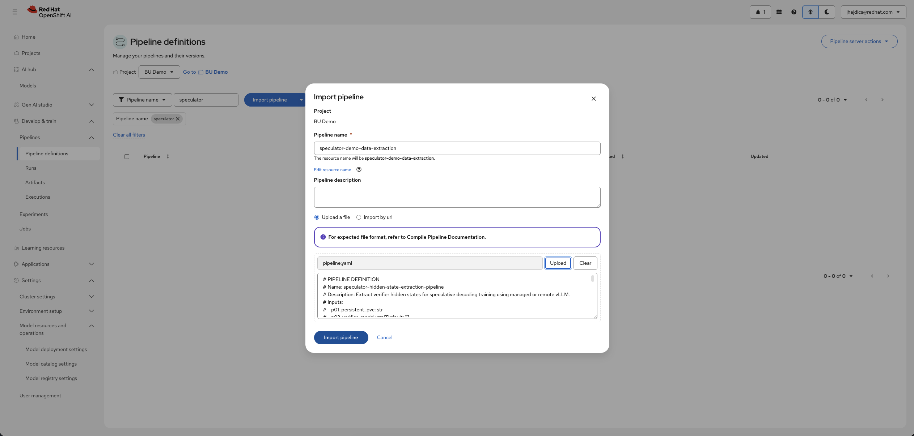
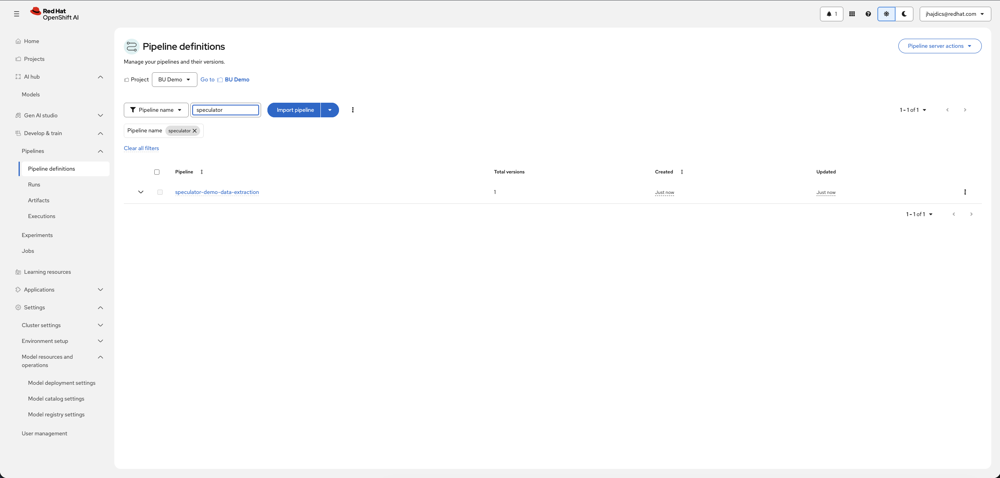
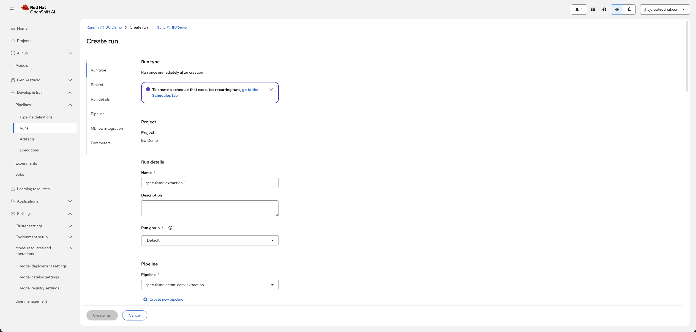
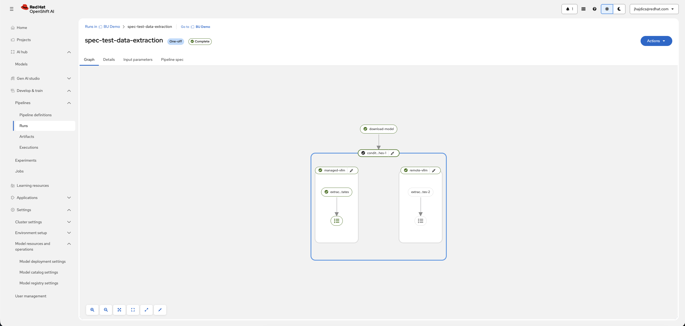

# Pipelines for Speculative Decoding Draft Model Training on Red Hat OpenShift AI

> [!WARNING]
>
> **Stability: alpha** — the upstream speculator pipelines are not yet stable and may change. Re-generate the pipeline YAML after pulling upstream changes.

This guided example walks through training a custom Eagle3 draft model for speculative decoding using **Kubeflow Pipelines** on Red Hat OpenShift AI. It covers generating each pipeline definition from source, importing it into Red Hat OpenShift AI, running it, interpreting the evaluation results, and testing the served endpoint.

> [!TIP]
>
> Prefer driving TrainJobs directly from a notebook instead of pipelines? See the SDK-based examples at [`../../../rhoai-3.6/speculator/`](../../../rhoai-3.6/speculator/) — same four training modes, executed via the Kubeflow SDK `SpeculativeDecodingTrainer`.

## What is Speculative Decoding?

Large language models generate tokens one at a time during inference. Each token requires reading the entire model from GPU memory (e.g., 140 GB for a 70B model in FP16), but the actual computation for one token is tiny. The GPU spends most of its time waiting for data to arrive from memory — running at under 1% compute utilization during normal token generation. This is called being **memory-bound**.

Speculative decoding exploits a key insight: verifying multiple tokens at once costs almost the same as generating one, because the expensive part (reading the model from memory) is identical and the GPU's compute units are idle anyway. A small, fast **draft model** (~1.2 GB with Qwen3-0.6B) quickly guesses the next several tokens, then the large **verifier model** checks all guesses at once in a single forward pass. Correct guesses become output; at the first rejected guess, the verifier's own token is used and the draft model starts guessing again. The output is mathematically identical to normal decoding — no quality loss.

For more background — why custom draft models matter after fine-tuning, and how the Eagle3 architecture reads hidden states from four intermediate verifier layers — see the [SDK example README](../../../rhoai-3.6/speculator/README.md#what-is-speculative-decoding).

## Pipelines Overview

There are four pipelines, one per training mode. Each is a separate pipeline definition in the [`pipelines-components`](https://github.com/red-hat-data-services/pipelines-components/tree/main/pipelines/training/speculator) repository, with a subfolder here holding its guide:

| Pipeline | SDK-mode analog | Use Case | Guide |
| --- | --- | --- | --- |
| Hidden State Extraction | `DATA_ONLY` | First step of a two-step workflow. Extract hidden states once, then iterate on training many times. | [data-extraction/](data-extraction/) |
| Training | `TRAIN_ONLY` | Second step of the two-step workflow. Trains, evaluates, registers, and serves a draft from artifacts left by the extraction pipeline. | [train-only/](train-only/) |
| Online | `ONLINE` | Single Trainer job: a managed vLLM sidecar extracts hidden states on the fly while the draft trains. Simplest one-run path. | [online/](online/) |
| Offline | `OFFLINE` | Extraction via an external (user-managed) vLLM endpoint, then training — all in one run. For when you already run your own vLLM. | [offline/](offline/) |

Every pipeline that trains also **evaluates** the draft with GuideLLM (acceptance metrics), optionally **registers** it to the Kubeflow Model Registry (mandatory in train-only), and **serves** it with a KServe speculative-decoding endpoint.

New to the two-step vs one-run distinction? Start with [data-extraction](data-extraction/), verify its output on the PVC as its guide describes, then move on to [train-only](train-only/).

## Red Hat OpenShift AI compatibility

This example is compatible with Red Hat OpenShift AI 3.6. The pipelines additionally require:

- Kubeflow Pipelines **>= 2.15.2** (the Red Hat OpenShift AI `aipipelines` component's pipeline server)
- Kubeflow Trainer **>= 0.1.0** (the Red Hat OpenShift AI `trainer` component)
- For the training pipelines: Model Registry **>= 0.3.4**, KServe **>= 2.10.0**, vLLM ServingRuntime **>= 0.24.0**
- Kubernetes (OpenShift) **>= 1.28**

## Requirements

- An OpenShift cluster with Red Hat OpenShift AI 3.6 installed:
  - The **dashboard**, **trainer**, and **aipipelines** components enabled
  - The **pipeline server** running — see [Prerequisites](#configure-the-pipeline-server)
  - The **modelregistry** component enabled (required for the train-only pipeline; optional elsewhere)
- Speculator **ClusterTrainingRuntimes (CTRs)** deployed — see [ClusterTrainingRuntimes](#clustertrainingruntimes-ctrs)
- Worker nodes with **NVIDIA GPUs** (Ampere or newer recommended) — the CTRs are CUDA-based
- An **existing ReadWriteMany PVC** — see [Existing RWX PVC](#existing-rwx-pvc)
- Python 3.11+ on your workstation or workbench, to generate the pipeline YAML
- A HuggingFace account and token (recommended, to avoid rate limits; Qwen3-0.6B is not gated)

## Hardware requirements

Values below are for the default **Qwen3-0.6B** verifier. Requirements scale with verifier model size.

| Pipeline | Training GPU | vLLM sidecar GPU | Evaluation / Serving GPU | Total GPUs (min) |
| --- | --- | --- | --- | --- |
| data-extraction (managed vLLM) | — | 1 | — | 1 |
| data-extraction (remote vLLM) | — | — (external) | — | 0 |
| train-only | 1 | — | ~1 | 2 |
| online | 1 | 1 | ~1 | 3 |
| offline | 1 | — (external) | ~1 | 2 |

> [!NOTE]
>
> - The vLLM sidecar currently supports exactly 1 GPU (`p12_vllm_resource_gpu`).
> - Evaluation (GuideLLM) and the KServe endpoint each consume roughly one GPU while active.
> - Offline mode uses your external vLLM server's own resources — size it separately.

## Prerequisites

Work through every section below before running any of the pipelines. The [Quick Start](#quick-start) assumes all of them are in place.

### Existing RWX PVC

These pipelines store all models, datasets, hidden states, checkpoints, and outputs on a shared PersistentVolumeClaim that you must provide before running anything: `p01_persistent_pvc` names an **existing** ReadWriteMany PVC in the pipeline namespace, which the pipeline mounts at `/mnt/persistent`. The pipelines never create or resize it.

> [!IMPORTANT]
>
> There are **two** PVCs involved in every run:
>
> 1. **Your persistent PVC** (`p01_persistent_pvc`) — pre-existing, holds the verifier, datasets, hidden states, checkpoints, and the final draft. Must be RWX and visible to the serving namespace.
> 2. **The KFP workspace PVC** — created by the pipeline itself at run time (200Gi, storage class `nfs-csi`, ReadWriteMany) for the Kubeflow Pipelines launcher tasks. Its size and storage class are set at compile time; see [Customizing before you compile](#customizing-before-you-compile).

Create the PVC once in the Red Hat OpenShift AI dashboard: open your project, choose the **Storage** tab, click **Add workbench storage** (or equivalent), name it (this guide uses `shared`), set size 100Gi, and select a storage class with **ReadWriteMany** access. Alternatively with `oc`:

```bash
oc apply -f - <<EOF
apiVersion: v1
kind: PersistentVolumeClaim
metadata:
  name: shared
spec:
  accessModes: ["ReadWriteMany"]
  resources:
    requests:
      storage: 100Gi
EOF
```


Verify it's bound:

```bash
oc get pvc shared
```

Expected: `STATUS Bound`.

### Configure the pipeline server

The pipeline server must be running for your project before you can import or run pipelines. In the Red Hat OpenShift AI dashboard, open your project, choose the **Pipelines** tab, and click **Configure pipeline server** if it is not already configured. Provide the object storage connection details it asks for (an S3-compatible bucket — the same kind used for any pipeline work; artifacts land there).


For the official documentation, see [configuring a pipeline server](https://docs.redhat.com/en/documentation/red_hat_openshift_ai_self-managed/3.6/html/working_with_ai_pipelines/managing-ai-pipelines_ai-pipelines#configuring-a-pipeline-server_ai-pipelines).

### Kubernetes authentication secret

The pipeline submits Trainer jobs through the Kubernetes API and requires a secret named `kubernetes-credentials` **in the project namespace**:

| Key | Description |
| --- | --- |
| `KUBERNETES_SERVER_URL` | Kubernetes API server URL (e.g., `https://api.cluster.example.com:6443`) |
| `KUBERNETES_AUTH_TOKEN` | Service account token with permissions to create Trainer jobs |

```bash
oc create secret generic kubernetes-credentials \
  --from-literal=KUBERNETES_SERVER_URL="https://api.your-cluster.com:6443" \
  --from-literal=KUBERNETES_AUTH_TOKEN="<your-service-account-token>"
```

> [!NOTE]
>
> This is the only **required** secret and is non-optional for all four pipelines. Scope the token to the minimum Trainer API permissions needed for runtime selection, job submission, and monitoring. It is mounted only in the KFP launcher tasks, never forwarded to Trainer workers.

Verify:

```bash
oc get secret kubernetes-credentials
```

### Optional hf-token secret

Only needed for gated models or rate-limit-free downloads:

```bash
oc create secret generic hf-token \
  --from-literal=HF_TOKEN="<your-huggingface-token>"
```

Qwen3-0.6B is not gated, so this example runs without it.

### ClusterTrainingRuntimes (CTRs)

The Trainer jobs reference CTRs by name via the `pNN_job_runtime` parameter. Check what is installed:

```bash
oc get clustertrainingruntimes
```

| CTR name | Used by |
| --- | --- |
| `vllm-extract-cuda` | data-extraction (managed mode), online |
| `speculator-model-opt-cuda` | train-only, offline, data-extraction (remote mode) |

If missing, follow the [SDK example's CTR instructions](../../../rhoai-3.6/speculator/README.md) or deploy them from the Kubeflow Trainer runtime definitions.

### Model Registry and KServe (train-only / online / offline)

The train-only pipeline **always** registers the draft — registry setup is mandatory there. Online and offline skip registration when the registry address is left empty.

**1. Create or select a registry.** In the Red Hat OpenShift AI dashboard, open **AI Hub > Models > Model registries** and create or select a registry.


**2. Find the registry's REST route.** Red Hat OpenShift AI gives each model registry its own dedicated REST route, named after the registry. Find yours with:

```bash
oc get routes -A | grep rest
```

For a registry named `bu-registry`, the route host looks like `bu-registry-rest.apps.<cluster-domain>`. The pipeline parameters are then the route URL **including the `https://` scheme** and the HTTPS port:

| Parameter (train-only names) | Value |
| --- | --- |
| `p02_model_registry_address` | `https://bu-registry-rest.apps.<cluster-domain>` |
| `p45_model_registry_port` | `443` |

> [!IMPORTANT]
>
> - Include the scheme in the address, matching how the endpoint is served — `https://` for Red Hat OpenShift AI routes, which is the normal case. Without a scheme the pipeline falls back to plain HTTP, which the route does not serve. If your endpoint is plain HTTP (a custom ingress without TLS, or a route with an insecure-edge policy), use `http://` and that endpoint's port; the same rules apply.
> - Do **not** paste the dashboard's REST URL (`https://<dashboard-host>/model-registry/<name>/api/model_registry/v1alpha3`). The pipeline appends the `/api/...` path itself, and the extra `/model-registry/<name>` prefix breaks the request. Always use the dedicated `-rest` route.
> - Alternative, in-cluster: the registry's Service works too — address `model-registry-<name>.<namespace>.svc` (no scheme), port `8080`. Find it with `oc get svc -A | grep model-registry`.

**3. Grant the pipeline ServiceAccount access.** The pipeline runs under your project's default ServiceAccount (`default` in the project namespace unless configured otherwise). Grant it read access to the registry:

```bash
oc create rolebinding registry-access-<project> \
  --namespace=<registry-namespace> \
  --clusterrole=registry-user-<registry-name> \
  --serviceaccount=<project-namespace>:default
```

**4. Serving namespace.** The serving namespace must be able to access the persistent PVC, and the pipeline ServiceAccount needs permission to manage ServingRuntimes and InferenceServices there. Using the same namespace as the PVC (typically your project namespace) is the simplest working setup.

## Quick Start

The steps below use the data-extraction pipeline as the worked example, but the flow is identical for all four modes — only the parameters differ (each mode's guide has its parameter table).

### 1. Generate the pipeline YAML

The compiled pipeline YAML is not included in this repository — you generate it from the pipeline source in `pipelines-components`. Each pipeline's `pipeline.py` compiles itself when executed, writing `pipeline.yaml` beside it.

**Requirements:** Python 3.11+ and the KFP SDK.

```bash
# Clone the pipelines repository
git clone https://github.com/red-hat-data-services/pipelines-components.git
cd pipelines-components

# Set up an isolated environment
python3 -m venv .venv
source .venv/bin/activate

# Install the repository. This is required — the pipelines import shared
# `kfp_components` modules, and compilation fails with ModuleNotFoundError
# without it. The KFP SDK (kfp, kfp-kubernetes) comes with it: both are
# declared as dependencies in the repository's pyproject.toml.
pip install -e .

# Compile the pipeline you want (one of: data_extraction, train_only, online, offline)
PYTHONPATH=$(pwd) python pipelines/training/speculator/data_extraction/pipeline.py

# The compiled pipeline is written next to its source:
# pipelines/training/speculator/data_extraction/pipeline.yaml
```

Repeat the last command for each mode you plan to run. To compile all four at once:

```bash
for mode in data_extraction train_only online offline; do
  PYTHONPATH=$(pwd) python "pipelines/training/speculator/$mode/pipeline.py"
done
```

> [!NOTE]
>
> - `pip install -e .` installs whichever KFP release satisfies the repository's declared range (`>=2.16.1`) — usually the latest. For the exact versions the repository itself is tested with, install from its hash-pinned requirements instead: `pip install -r requirements.txt`.
> - Compilation is **not** byte-reproducible — each pipeline embeds an archive of its component sources, so two compiles of the same commit produce slightly different files. This is expected and does not affect the pipeline.

**Expected result:** four `pipeline.yaml` files (or the one you need), one under each `pipelines/training/speculator/<mode>/` directory. Each is roughly 100–200 KB.

### 2. Create the prerequisites

Work through [Prerequisites](#prerequisites): PVC, pipeline server, `kubernetes-credentials` secret, CTRs, and (for train-only / serving) Model Registry. Each subsection above includes a verification command — run them.

### 3. Import the pipeline into Red Hat OpenShift AI

1. In the Red Hat OpenShift AI dashboard, click **Develop & train** in the left navigation.
2. Choose **Pipelines**.
3. If the pipeline server was just configured, wait until the **Pipeline definitions** page loads without a configuration prompt.
4. Click **Import pipeline** (the button at the top of the **Pipeline definitions** page).
5. In the dialog:
   - **Name**: a display name, e.g. `speculator-hidden-state-extraction`
   - **Pipeline file**: select **Upload a file** and choose the `pipeline.yaml` you compiled in step 1.
6. Click **Import**.



**Expected result:** the pipeline appears in the **Pipeline definitions** list. The definition name is taken from the YAML: `speculator-hidden-state-extraction-pipeline` (data-extraction), `speculator-training-pipeline` (train-only), `speculator-online-pipeline` (online), `speculator-offline-pipeline` (offline).



### 4. Create a run and set parameters

1. On the **Pipeline definitions** page, click the imported pipeline.
2. Click **Create run**.
3. In the run dialog:
   - **Run name**: something meaningful, e.g. `speculator-extraction-1`
   - **Experiment**: leave the default experiment or create one
   - **Parameters**: fill in the values from the mode's example table (linked below). Parameters appear in `p01…` order — booleans render as toggles, and everything with a default can be left alone unless the table says otherwise.
4. Click **Start**.



The ready-to-copy parameter tables:

- [data-extraction](data-extraction/README.md#example-qwen3-06b)
- [train-only](train-only/README.md#example-qwen3-06b)
- [online](online/README.md#example-qwen3-06b)
- [offline](offline/README.md#example-qwen3-06b)

### 5. Watch the run

1. From the run confirmation (or **Pipelines > Runs**), open the run. The pipeline graph shows each task as a node.
2. Node colors track state: pending, running, succeeded, failed.
3. Click any node to open its detail pane — **Logs** for stdout/stderr, **Artifacts** for its outputs.
4. Tasks run sequentially in these pipelines (extraction before training, training before evaluation, etc.), so a failure early in the graph stops everything downstream. The failing node's logs are the first place to look.



When the run succeeds, continue with the mode's guide — for the two-step workflow that means [verifying the output on the PVC](data-extraction/README.md#verifying-the-output-on-the-pvc) and then the [train-only pipeline](train-only/README.md), whose guide covers [interpreting the evaluation results](train-only/README.md#interpreting-the-evaluation-results).

## Testing the served endpoint

Every training pipeline leaves a **cluster-local** KServe InferenceService behind. This section is the procedure that works — each step below was verified against a live Red Hat OpenShift AI 3.6 cluster. (Also see the train-only guide's [Testing the served endpoint](train-only/README.md#testing-the-served-endpoint) for the mode-specific details.)

> [!IMPORTANT]
>
> The endpoint is **cluster-local**: its URL is `<name>-predictor.<namespace>.svc.cluster.local` and resolves **only inside the cluster**. Running `curl` against it from your laptop fails with `Could not resolve host` — that is expected, not a broken deployment.

**1. Find the InferenceService and its URL:**

```bash
oc get inferenceservice -n <project-namespace>
```

The `URL` column shows the cluster-local address. Note the deployment name is `<name>-predictor`.

**2. Discover the model id** — this is the step people get wrong. The vLLM server registers the model under the **InferenceService name**, not the verifier model ID. Ask it:

```bash
oc exec -n <project-namespace> deploy/<name>-predictor -c kserve-container -- \
  curl -s localhost:8080/v1/models
```

The response's `data[0].id` is the model id to use in requests.

> [!NOTE]
>
> The container listens on port **8080**. The Service in front of it may expose a different port (often 80) — see the port-forward caveat below.

**3. Send a chat request** (from anywhere `oc` is logged in — the command executes inside the predictor container):

```bash
oc exec -n <project-namespace> deploy/<name>-predictor -c kserve-container -- \
  curl -s localhost:8080/v1/chat/completions \
  -H "Content-Type: application/json" \
  -d '{"model": "<name>", "messages": [{"role": "user", "content": "What is the capital of France?"}], "max_tokens": 200}'
```

The answer is in `choices[0].message.content`.

**4. (Optional) Access from your laptop** with port-forwarding:

```bash
oc port-forward -n <project-namespace> deploy/<name>-predictor 5000:8080
```

Then `curl http://localhost:5000/v1/models` (and the chat request with `http://localhost:5000/...`) from any local terminal.

> [!WARNING]
>
> Forward to the **container** port `8080`, not the Service's port. `oc port-forward` performs no Service port translation — it dials a port **inside the pod's network namespace**, where the vLLM server listens on 8080. Forwarding to the Service's port 80 yields `connection refused` even though everything is healthy. Keep the port-forward terminal open; re-run the command if it drops.

**5. (Optional) Pretty-print just the answer** with `jq`:

```bash
oc exec -n <project-namespace> deploy/<name>-predictor -c kserve-container -- \
  curl -s localhost:8080/v1/chat/completions \
  -H "Content-Type: application/json" \
  -d '{"model": "<name>", "messages": [{"role": "user", "content": "What is the capital of France?"}], "max_tokens": 200}' \
  | jq -r '.choices[0].message.content'
```

For an interactive session (repeated questions, or a conversation that keeps history), port-forward once as in step 4 and drive `http://localhost:5000` with curl or a small script — every request is independent unless you pass the full message history yourself.

## Default verifier model

These examples standardize on **`Qwen/Qwen3-0.6B`** with `target_layer_ids = "2,14,25,28"` (the four intermediate verifier layers Eagle3 reads). **`meta-llama/Llama-3.2-1B-Instruct`** has also been run end-to-end successfully on Red Hat OpenShift AI 3.6 with these pipelines.

The layer IDs are **verifier-specific**: they name four layers *of the verifier model*, and a wrong set fails at training time with a tensor shape mismatch. For Qwen3-0.6B use `2,14,25,28`; for any other verifier, look up that model's four Eagle3 target layers (see the [SDK example's guidance](../../../rhoai-3.6/speculator/README.md#speculator-specific-considerations)) — do not reuse Qwen's IDs for a different architecture.

## Customizing before you compile

Most settings — models, datasets, paths, hyperparameters, resources — are run-time parameters you fill in when creating the run. A few are baked in at compile time and can only be changed by editing the pipeline source before running step 1:

| Setting | Where | Default |
| --- | --- | --- |
| KFP workspace PVC size | `PVC_SIZE` in the mode's `pipeline.py` | `200Gi` |
| KFP workspace PVC storage class | `PVC_STORAGE_CLASS` in the mode's `pipeline.py` | `nfs-csi` |
| KFP workspace PVC access modes | `PVC_ACCESS_MODES` in the mode's `pipeline.py` | `["ReadWriteMany"]` |

Edit the constants near the top of the file, then re-run the compile command. `nfs-csi` will not exist on many clusters — check with `oc get storageclass` and substitute your RWX class.

## Troubleshooting

Compile and run-time problems, ordered roughly by when you'd hit them:

| Symptom | Diagnosis | Fix |
| --- | --- | --- |
| Compile fails: `ModuleNotFoundError: No module named 'kfp_components'` | The `pipelines-components` repo was not installed as a package | Run `pip install -e .` from the repository root |
| Compile fails: `ModuleNotFoundError: No module named 'components'` | `PYTHONPATH` not set to the repository root | Prefix the command with `PYTHONPATH=$(pwd)` and run it from the repo root |
| `pip install -e .` fails to resolve dependencies | Your package index (e.g. an internal mirror) doesn't carry a required package or version | Install from the repo's hash-pinned requirements instead: `pip install -r requirements.txt` |
| Import into Red Hat OpenShift AI rejected | YAML built with an incompatible KFP SDK version | Re-compile with the pinned versions in step 1 |
| "Configure pipeline server" prompt never goes away | Pipeline server not running/configured for the project | See [Configure the pipeline server](#configure-the-pipeline-server) |
| Run fails immediately with `storageclass.storage.k8s.io "nfs-csi" not found` | Cluster has no `nfs-csi` storage class; the KFP workspace PVC cannot be created | Find your RWX class with `oc get storageclass`, then [recompile](#customizing-before-you-compile) with your class name |
| PVC stuck `Pending` | No RWX dynamic provisioner, or capacity exhausted | Talk to your cluster admin; RWX storage is required |
| Trainer submit task fails with 401/403 | `kubernetes-credentials` secret missing or token lacks Trainer permissions | Recreate the secret; scope the token to Trainer job creation |
| Run fails with ClusterTrainingRuntime not found | CTR from `pNN_job_runtime` not deployed | `oc get clustertrainingruntimes`; deploy the missing runtime |
| Training pod OOM-killed | Verifier too large for defaults, or `gpu_memory_utilization` too high | Raise `pNN_training_resource_memory`; lower `gpu_memory_utilization` |
| Registry task fails with connection refused or 404 | Wrong registry address/port, or missing RoleBinding | Use the registry's `-rest` route with the `https://` scheme and port `443` (or the in-cluster service with port `8080`); add the RoleBinding per [Prerequisites](#model-registry-and-kserve-train-only--online--offline) |
| Training fails: `HFValidationError: Repo id must be in the form 'repo_name' or 'namespace/repo_name'` | `verifier_model_pvc` uses the HuggingFace model ID format (e.g. `models/Qwen3-0.6B`) instead of the on-disk directory name | The download task replaces `/` with `--` in the model ID. Use the actual directory name: `models/Qwen--Qwen3-0.6B`. Check with `ls $PVC_MOUNT/models/` |
| Model download fails with 401 | Gated model without `hf-token` secret | Create the `hf-token` secret |
| `curl: Could not resolve host: <name>-predictor.<ns>.svc.cluster.local` | The URL is cluster-local; you are off-cluster (e.g. your laptop) | Run the request from inside the cluster via `oc exec`, or use `oc port-forward` — see [Testing the served endpoint](#testing-the-served-endpoint) |
| `connection refused` when port-forwarding to port 80 | The predictor container listens on **8080**; port-forward does no Service port translation | Forward to the container port: `oc port-forward ... 5000:8080` |
| Chat request returns "model not found" | Wrong model id — the server registers the model under the **InferenceService name**, not the verifier model ID | Discover the id with `oc exec ... -- curl -s localhost:8080/v1/models` |
| First request to the endpoint hangs or is refused | vLLM still loading the model into GPU, or KServe scaled the predictor to zero and it is waking | Check `oc get inferenceservice` shows `True`, check the predictor pod is `Running`, wait, retry |
| Older registry versions break after a re-run | `final_model` on the PVC is overwritten each run | Use a separate PVC per revision if old versions must keep referencing their weights |

More mode-specific symptoms are in each subfolder's guide.

## Source

The pipelines documented here live in [`red-hat-data-services/pipelines-components`](https://github.com/red-hat-data-services/pipelines-components/tree/main/pipelines/training/speculator) under `pipelines/training/speculator/`. The parameter tables in the mode guides are derived from that repository's own pipeline READMEs. Since the pipelines are alpha, re-generate your YAML after pulling upstream changes and re-check the parameter list against the imported definition.
