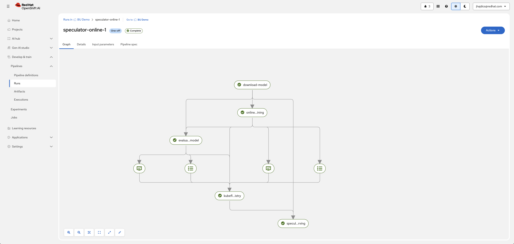
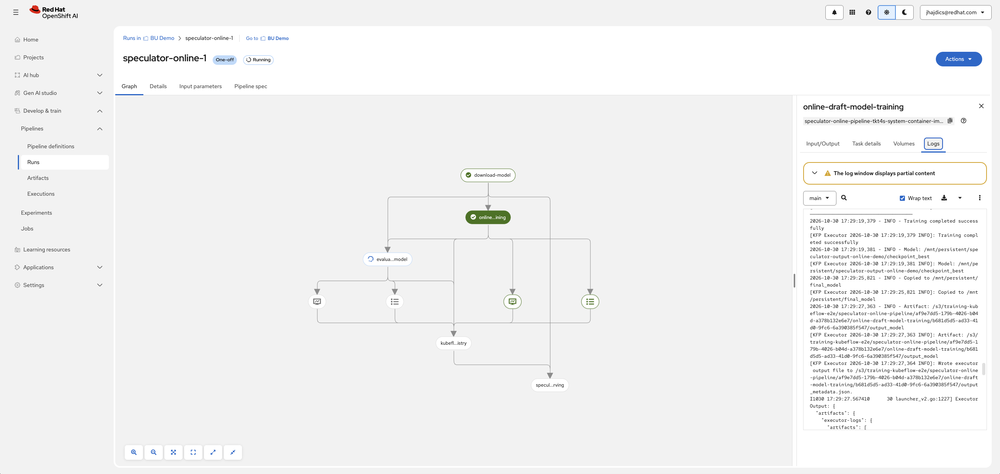
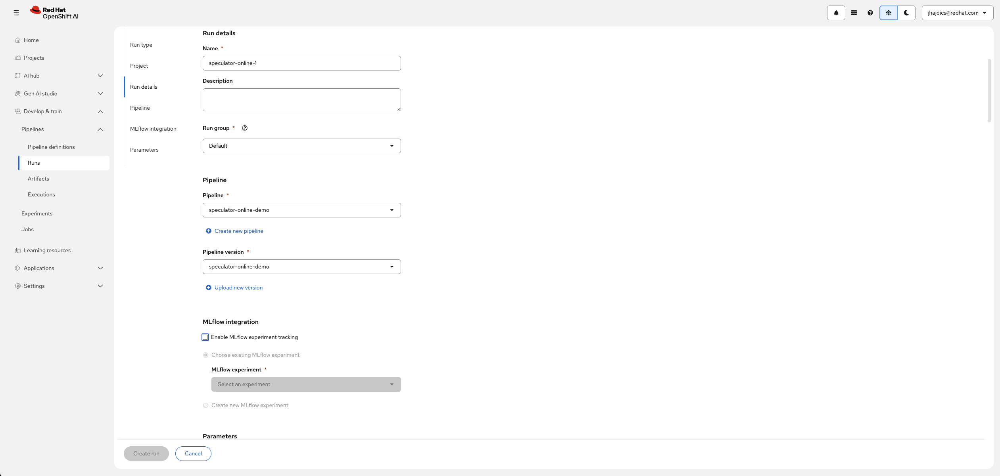
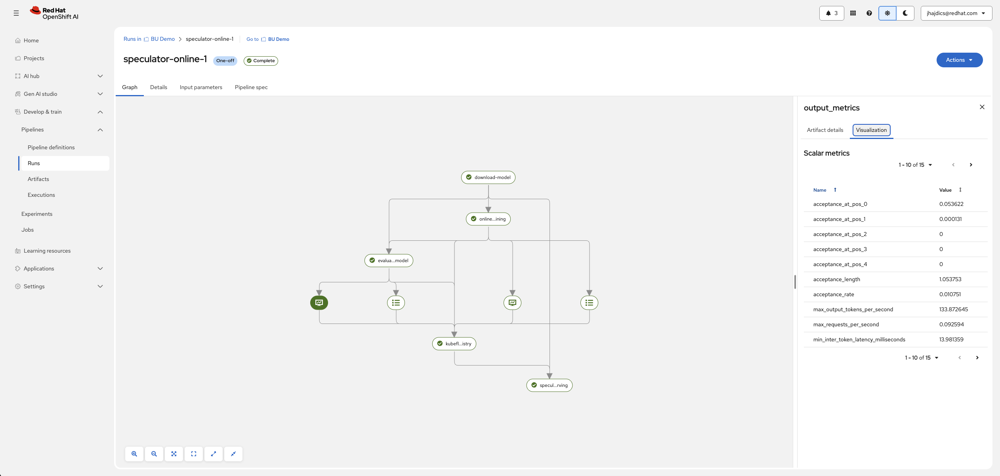
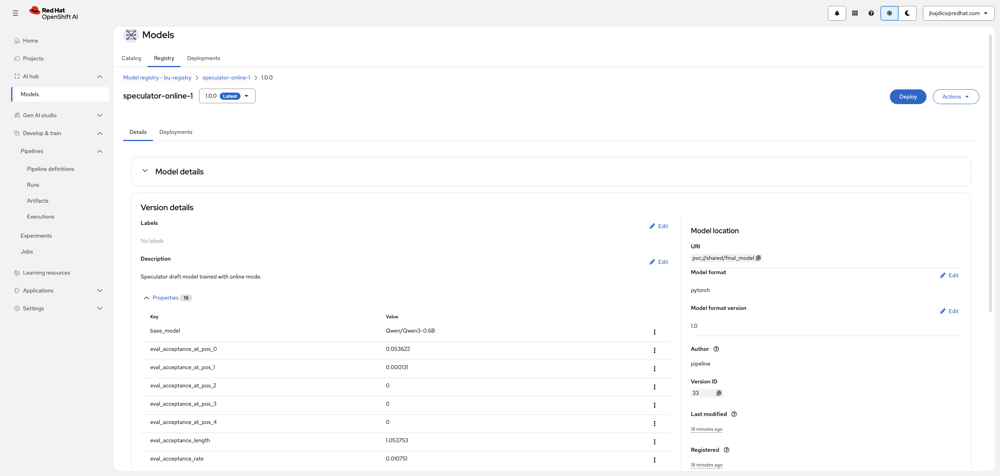
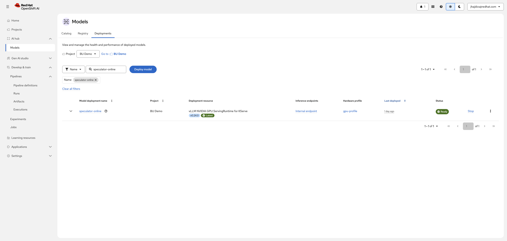

# Online Pipeline (single-job extraction + training)

> [!WARNING]
>
> **Stability: alpha** — this pipeline may change. Re-generate the YAML after pulling upstream changes.

This guide covers the **speculator-online-pipeline** — the simplest one-run path to a trained Eagle3 draft. A single Trainer job extracts hidden states with a managed vLLM sidecar **and** trains the draft, then the pipeline evaluates, optionally registers, and serves it.

## When to use this pipeline

- **Everything in one run.** No pre-existing extraction artifacts, no separate data-only runs, no external vLLM to operate. If you just want a trained draft with minimal setup, start here.
- Prefer separate extraction/training so you can sweep hyperparameters cheaply? Use [data-extraction](../data-extraction/) + [train-only](../train-only/). Already run your own vLLM? Use [offline](../offline/).

## How it works

1. (Optional) Download `p02_verifier_model` from HuggingFace to the PVC when `p04_download_model=true`; otherwise reuse `p03_verifier_model_pvc` or the default cache directory derived from the model ID.
2. **One Trainer job** runs with a managed vLLM sidecar: the sidecar generates hidden states on the fly while training consumes them.
3. **Evaluate** with GuideLLM.
4. **Register** — optional. Leave `p43_model_registry_address` empty to skip.
5. **Serve** via a cluster-local KServe InferenceService.

The completed draft is written to `pvc://<p01_persistent_pvc>/final_model`. Each run **replaces** this shared path — use a separate PVC per revision if earlier registry versions must keep referencing their original weights.

`p01_persistent_pvc` is an existing ReadWriteMany PVC in the pipeline namespace, mounted at `/mnt/persistent`. It must also be available in `p08_serving_namespace`. With `p01_persistent_pvc="shared"`, `p12_output_dir="speculator-output"` resolves to `pvc://shared/speculator-output`.

## The pipeline run from start to finish

With `p04_download_model=true` and registration enabled, the run graph looks like this:

```text
download model ──> online draft model training ──> evaluate draft model ──> register to model registry ──> serve draft model
                  (one Trainer job: extraction sidecar + training)
```

The defining feature is the **second node**: a single Trainer job that does extraction and training together. Stage by stage:

| Task in the graph | What it does | What you'll observe | Typical duration (Qwen3-0.6B smoke test) |
| --- | --- | --- | --- |
| **download model** | (Only when `p04_download_model=true`) Pulls `p02_verifier_model` onto the PVC | Download progress in the node logs | ~1–2 minutes |
| **online draft model training** | One Trainer job (`vllm-extract-cuda` CTR): a vLLM sidecar serves the verifier and produces hidden states on the fly while the training worker consumes them | The longest node. Logs are quiet for the first few minutes while the sidecar loads the verifier, then training loss starts streaming. What looks like a hang at minute two is the sidecar loading | ~10–30 minutes |
| **evaluate draft model** | Starts a vLLM server with speculative decoding and runs the GuideLLM sweep | Slow start (server load), then results publish as **metrics artifacts** | ~5–15 minutes |
| **register to model registry** | (Skipped entirely when `p43_model_registry_address` is empty) Registers `final_model` | Seconds; fails fast on wrong address or missing RoleBinding | Seconds |
| **serve draft model** | Creates the KServe InferenceService and waits for readiness | ServingRuntime + InferenceService creation, predictor rollout | ~2–5 minutes |

What the cluster side looks like during the run is covered next, in [What a running job looks like](#what-a-running-job-looks-like).





## What a running job looks like

While the Trainer job runs, the project namespace contains **one TrainJob with two GPU containers**: the training worker and the vLLM sidecar (`vllm-extract-cuda` CTR). You can watch it with:

```bash
oc get trainjobs,pods -n <project-namespace>
```

The sidecar takes minutes to load the verifier into GPU before extraction starts — a pod in `Running` state with no training log output yet is normal during that window. Total GPUs in use while training: `p29_training_resource_gpu` + 1 (the sidecar is always exactly 1).

## Hardware requirements (Qwen3-0.6B)

| Component | GPU | CPU | Memory |
| --- | --- | --- | --- |
| Training worker | 1 (`p29`) | 4 cores | 64Gi |
| vLLM sidecar | 1 (hardcoded — always exactly 1) | — | 96Gi |
| Evaluation / serving | ~1 | — | — |

Total: training GPUs + 1 sidecar GPU + evaluation/serving.

## Setup

Work through the [shared prerequisites](../README.md#prerequisites):

- Existing RWX PVC (`p01_persistent_pvc`)
- Pipeline server configured for the project
- `kubernetes-credentials` secret (required)
- CTR `vllm-extract-cuda` (`p34_job_runtime` default)
- Model Registry + RoleBinding + serving namespace permissions — only if you keep registration enabled. To register, use the registry's `-rest` route URL (`https://...`, scheme included) with port `443` in `p44_model_registry_port`; see the [common prerequisites](../README.md#model-registry-and-kserve-train-only--online--offline)

The three setup steps this mode depends on, as they look in the dashboard:


All are covered step by step — with verification commands — in the [common prerequisites](../README.md#prerequisites).

Set `PIP_INDEX_URL`/`PIP_EXTRA_INDEX_URL` via `p36_job_envs` if you need a custom package index for `p35_packages_to_install`.

## Verifier model

`p02_verifier_model` is the optional HuggingFace model ID, used for downloading or resolving the default cached directory. `p04_download_model` defaults to `false`:

- Downloads enabled → the model ID is downloaded before training.
- Downloads disabled → supply an existing directory with `p03_verifier_model_pvc` (relative path or matching `pvc://` URI), or the default cache directory derived from the model ID is used.

Create the optional `hf-token` secret if downloading requires authentication.

> [!IMPORTANT]
>
> `p05_target_layer_ids` is **required** — four comma-separated layer IDs matching the verifier. The online Trainer receives the cached model as a PVC URI and cannot auto-detect layer IDs from the PVC-backed model config. For Qwen3-0.6B: `2,14,25,28`. Layer IDs are verifier-specific — look them up per model, do not reuse Qwen's IDs for a different architecture.

## Dataset

`p06_dataset_name` accepts the built-ins `magpie` (Magpie-Align/Magpie-Llama-3.1-Pro-300K-Filtered), `ultrachat` (HuggingFaceH4/ultrachat_200k), and `gsm8k` (openai/gsm8k), or a PVC URI (`pvc://<p01_persistent_pvc>/<path>`) to a JSON/JSONL file. `p09_data_extraction_max_samples=0` processes the full dataset; `p11_data_extraction_concurrency` controls vLLM request concurrency (use `1` on shared/NFS PVCs).

## Key ONLINE configuration

Some training internals are hardcoded in this pipeline rather than exposed: the cosine-scheduler cycle count (`0.5`), checkpoint frequency (every epoch), log frequency (every step), sidecar GPU count 1, evaluation sample seed 42.

### Not used in ONLINE

There are no parameters for the settings listed above, and no separate extraction pipeline to coordinate paths with — `p12_output_dir` covers Trainer outputs and checkpoints.

## Running the pipeline

**Step 1 — generate the pipeline YAML.** Follow [Generate the pipeline YAML](../README.md#1-generate-the-pipeline-yaml) in the common guide, compiling the `online` mode:

```bash
PYTHONPATH=$(pwd) python pipelines/training/speculator/online/pipeline.py
```

This writes `pipelines/training/speculator/online/pipeline.yaml`.

**Step 2 — import it into Red Hat OpenShift AI.** Follow the click-by-click instructions in [Import the pipeline into Red Hat OpenShift AI](../README.md#3-import-the-pipeline-into-red-hat-openshift-ai). The imported definition is named `speculator-online-pipeline`.

**Step 3 — create a run.** Open the pipeline definition, click **Create run**, and fill in the parameters from the table below. Leave everything not listed at its default. Use a new `p46_model_registry_version` per revision if registering.



**Step 4 — start the run and watch it.** Click **Start**. The stage-by-stage walkthrough is in [The pipeline run from start to finish](#the-pipeline-run-from-start-to-finish); the common guide covers the [UI mechanics](../README.md#5-watch-the-run) of watching a run.

### Example: Qwen3-0.6B

| Parameter | Value | Notes |
| --- | --- | --- |
| `p01_persistent_pvc` | `shared` | Your existing RWX PVC name |
| `p02_verifier_model` | `Qwen/Qwen3-0.6B` | Downloaded because `p04_download_model=true` |
| `p04_download_model` | `true` | Cache the verifier on the PVC |
| `p05_target_layer_ids` | `2,14,25,28` | **Required** |
| `p06_dataset_name` | `ultrachat` | Built-in dataset |
| `p07_evaluation_dataset_uri` | `RedHatAI/speculator_benchmarks` | HuggingFace evaluation dataset with built-in subsets |
| `p08_serving_namespace` | `<pvc-namespace>` | Must access the PVC |
| `p09_data_extraction_max_samples` | `16` | Smoke test; set `0` for the full dataset |
| `p35_packages_to_install` | `speculators==0.6.0.1,torchvision==0.24.0` | Comma-separated packages installed in the online Trainer job |
| `p37_evaluation_max_samples` | `10` | Reduced for quick testing; default `80` for full runs |
| `p38_evaluation_max_tokens` | `64` | Reduced for quick testing; default `256` for full runs |
| `p43_model_registry_address` | `""` | Empty skips registration; to register, use `https://<registry-name>-rest.apps.<cluster-domain>` |
| `p44_model_registry_port` | `443` | Set alongside a non-empty registry address — the default `8080` only fits the in-cluster service |

Training/evaluation/resource parameters can keep their defaults for a first run.

## Interpreting the results

Same evaluation task and metrics as the train-only pipeline — see [Interpreting the evaluation results](../train-only/README.md#interpreting-the-evaluation-results) in that guide for the full metric table and how to read it. The short version: check `acceptance_length` (mean tokens per verifier pass; higher is better, 1 means the draft contributes nothing), and remember the pipeline emits **no speedup ratio** — only absolute throughput numbers.

The evaluation task's metrics in the Red Hat OpenShift AI UI:



If you kept registration enabled (`p43_model_registry_address` set), the draft appears in the Model Registry afterwards under `p45_model_registry_name` / `p46_model_registry_version` — find it via **AI Hub > Models > Model registries > your registry**:



## Testing the served endpoint

Follow [Testing the served endpoint](../README.md#testing-the-served-endpoint) in the common guide. One online-specific note: KServe may scale the predictor to zero after a period of idleness — the first request after a quiet period can take a while or be refused while the predictor wakes. Check `oc get inferenceservice -n <p08_serving_namespace>` shows `True` before concluding something is broken.

The deployed endpoint in the Red Hat OpenShift AI UI:



## Iterating / customization

Sweep `p14_training_epochs`, `p15_training_lr`, `p17_training_num_layers`, and `p40_evaluation_num_speculative_tokens` between runs. Note that each run repeats extraction — if you find yourself iterating often, switch to the two-step [data-extraction](../data-extraction/) + [train-only](../train-only/) workflow and only pay for extraction once.

## Full Parameter Reference

| Parameter | Type | Default | Description |
| --------- | ---- | ------- | ----------- |
| `p01_persistent_pvc` | `str` | `None` | Required name of the existing ReadWriteMany PVC in the pipeline namespace. Stores the downloaded verifier, Trainer outputs, and final draft; KServe must also access it in `p08_serving_namespace`. Mounted at `/mnt/persistent`. |
| `p05_target_layer_ids` | `str` | `None` | Required. Four comma-separated layer IDs matching the verifier; cannot be auto-detected in online mode. |
| `p06_dataset_name` | `str` | `None` | Required built-in dataset name (`magpie`, `ultrachat`, `gsm8k`) or PVC URI to a JSON/JSONL file. |
| `p07_evaluation_dataset_uri` | `str` | `None` | Required evaluation dataset. Use `RedHatAI/speculator_benchmarks` (HuggingFace) or a `pvc://` URI pointing to a local JSONL file on `p01_persistent_pvc`. See [Preparing the evaluation dataset](../train-only/README.md#preparing-the-evaluation-dataset). |
| `p08_serving_namespace` | `str` | `None` | Required KServe namespace; must access the PVC. |
| `p02_verifier_model` | `str` | `""` | Optional HuggingFace model ID used for downloading or resolving the default cached directory. |
| `p03_verifier_model_pvc` | `str` | `""` | Optional existing verifier directory on the shared PVC. Use the on-disk directory name (`models/Qwen--Qwen3-0.6B`), not the HuggingFace model ID — the download task replaces `/` with `--`. Used when `p04_download_model` is false. |
| `p04_download_model` | `bool` | `False` | Download the model specified by `p02_verifier_model` to the shared PVC. |
| `p09_data_extraction_max_samples` | `int` | `0` | Maximum training examples extracted by the sidecar; `0` processes the full dataset. |
| `p10_data_extraction_regenerate_responses` | `bool` | `False` | Regenerate assistant responses with the verifier; built-in datasets only. |
| `p11_data_extraction_concurrency` | `int` | `1` | vLLM request concurrency and training `datagen_concurrency`. Use `1` on shared/NFS PVCs. |
| `p12_output_dir` | `str` | `speculator-output` | PVC-relative directory for Trainer outputs and checkpoints. The final draft is copied to `final_model` at the PVC root. |
| `p13_total_seq_len` | `int` | `2048` | Positive maximum sequence length for extraction, training, and serving. |
| `p14_training_epochs` | `int` | `3` | Number of training epochs. |
| `p15_training_lr` | `float` | `0.0001` | Learning rate for draft-model training. |
| `p16_training_draft_vocab_size` | `int` | `0` | Draft vocabulary size. `0` lets the Trainer SDK derive it. |
| `p17_training_num_layers` | `int` | `1` | Number of layers in the draft model. |
| `p18_training_test_time_steps` | `int` | `1` | Number of test-time training steps configured for Speculator. |
| `p19_training_norm_before_residual` | `bool` | `True` | Apply normalization before the residual connection. |
| `p20_training_norm_before_fc` | `bool` | `False` | Apply normalization before the fully connected layer. |
| `p21_training_embed_requires_grad` | `bool` | `False` | Whether draft embedding weights are trainable. |
| `p22_training_hidden_states_dtype` | `str` | `bfloat16` | Hidden-state dtype; must match the verifier model. |
| `p23_training_scheduler_type` | `str` | `linear` | LR scheduler: `linear`, `cosine`, or `none`. |
| `p24_training_scheduler_warmup_steps` | `int` | `0` | Warmup steps; `0` lets the SDK calculate them. |
| `p25_training_scheduler_total_steps` | `int` | `0` | Total scheduler steps; `0` lets the SDK calculate them. |
| `p26_training_save_best` | `bool` | `False` | Save the best checkpoint by validation loss. |
| `p27_training_resume_from_checkpoint` | `bool` | `False` | Resume from a saved checkpoint when supported by the runtime. |
| `p28_training_resource_cpu` | `str` | `4` | CPU request for the main Trainer worker. |
| `p29_training_resource_gpu` | `int` | `1` | GPUs for the main Trainer worker. The sidecar always requests one more. |
| `p30_training_resource_memory` | `str` | `64Gi` | Memory request for the main Trainer worker. |
| `p31_vllm_resource_memory` | `str` | `96Gi` | Memory request for the managed vLLM sidecar. |
| `p32_vllm_gpu_memory_utilization` | `float` | `0.9` | GPU memory fraction for the sidecar, in `(0, 1]`. |
| `p33_vllm_readiness_timeout_minutes` | `int` | `60` | Maximum wait in minutes for the sidecar to become ready. |
| `p34_job_runtime` | `str` | `vllm-extract-cuda` | ClusterTrainingRuntime for the online Trainer with vLLM extraction. |
| `p35_packages_to_install` | `str` | `""` | Comma-separated Python packages installed in the online Trainer job. |
| `p36_job_envs` | `str` | `NCCL_DEBUG=INFO,PYTHONUNBUFFERED=1` | Comma-separated `KEY=VALUE` environment overrides for the Trainer job. |
| `p37_evaluation_max_samples` | `int` | `80` | Maximum GuideLLM requests per evaluation sweep point; must be positive. |
| `p38_evaluation_max_tokens` | `int` | `256` | Maximum tokens generated per evaluation request; must be positive. |
| `p39_evaluation_temperature` | `float` | `0.0` | Sampling temperature passed to GuideLLM; `0` is deterministic. |
| `p40_evaluation_num_speculative_tokens` | `int` | `5` | Draft tokens proposed per step in evaluation and serving. |
| `p41_evaluation_gpu_memory_utilization` | `float` | `0.9` | GPU memory fraction for evaluation and serving, in `(0, 1]`. |
| `p42_evaluation_startup_timeout_seconds` | `int` | `900` | Maximum wait for the evaluation vLLM server to become ready. |
| `p43_model_registry_address` | `str` | `""` | Model Registry REST endpoint: the registry's `https://<name>-rest.apps.<cluster-domain>` route URL (scheme included), or the in-cluster service hostname. Empty (default) skips registration. |
| `p44_model_registry_port` | `int` | `8080` | Registry REST port: `443` for the `-rest` route, `8080` for the in-cluster service. |
| `p45_model_registry_name` | `str` | `speculator-online-draft` | Name assigned to the registered draft model. |
| `p46_model_registry_version` | `str` | `1.0.0` | Version label for this registration; new value per revision. |
| `p47_serving_endpoint_name` | `str` | `speculator-online` | DNS-compatible name for the KServe InferenceService. |
| `p48_serving_runtime_image` | `str` | `registry.redhat.io/rhaii-fast/vllm-cuda-rhel9@sha256:97c7d6f66f3f0897b3ff10ddd135de930d45bdd116cf41a43e3ad7270029116a` | Pinned compatible vLLM CUDA image pull spec used by KServe. |

## Troubleshooting

| Symptom | Diagnosis | Fix |
| --- | --- | --- |
| Run fails waiting for the vLLM sidecar | Sidecar crashed or verifier too large for `p32` | Check Trainer pod logs; raise `p33_vllm_readiness_timeout_minutes`; verify GPU memory |
| Training pod OOM-killed | Defaults too small for the verifier | Raise `p30_training_resource_memory` |
| Registry task fails | Wrong registry address or missing RoleBinding | Use the `-rest` route URL with `https://` and port `443` in `p44` (or the in-cluster service with `8080`); add the RoleBinding — or leave the address empty to skip |
| Serving task fails with forbidden | ServiceAccount lacks KServe permissions | Grant ServingRuntime/InferenceService manage rights in `p08_serving_namespace` |
| First request to the endpoint hangs or is refused | KServe scaled the predictor to zero, or vLLM is still loading | Check `oc get inferenceservice` shows `True`; wait and retry |
| Older registry versions break after re-run | `final_model` overwritten each run | Separate PVC per revision |
| Training fails: `HFValidationError: Repo id must be in the form 'repo_name' or 'namespace/repo_name'` | `p03_verifier_model_pvc` uses the HuggingFace model ID format (e.g. `models/Qwen3-0.6B`) instead of the on-disk directory name | The download task replaces `/` with `--` in the model ID. Use the actual directory name: `models/Qwen--Qwen3-0.6B`. Check with `ls $PVC_MOUNT/models/` |
| Slow extraction on shared storage | Concurrent I/O saturating NFS | Keep `p11_data_extraction_concurrency=1` |

Compile-time problems and endpoint-access problems are covered in the [common troubleshooting table](../README.md#troubleshooting).

## Source

Pipeline source: [`pipelines-components/pipelines/training/speculator/online`](https://github.com/red-hat-data-services/pipelines-components/tree/main/pipelines/training/speculator/online). The parameter table above is derived from that directory's `README.md` and `pipeline.py`; re-check it against your imported definition after pulling upstream changes.
