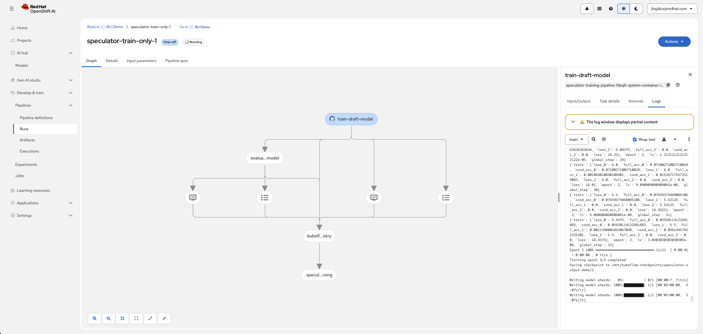
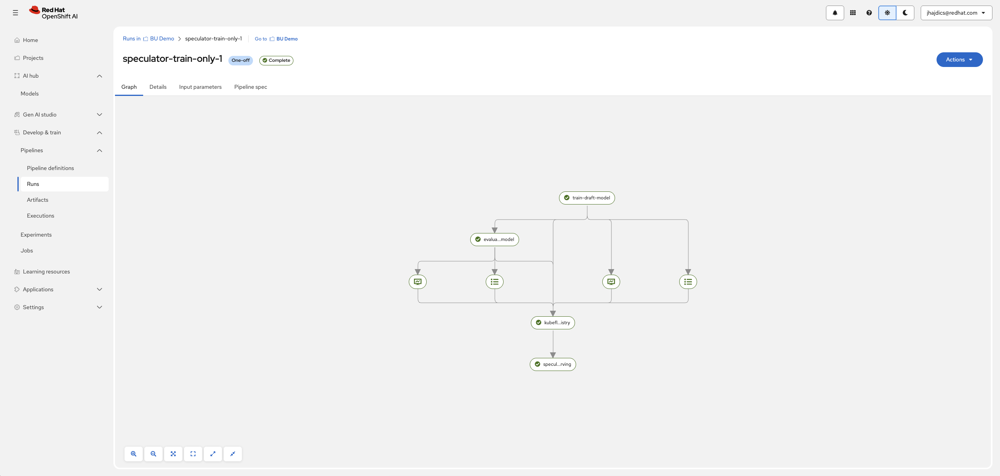
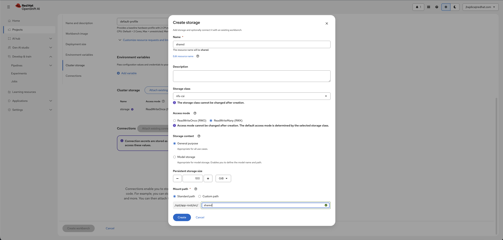
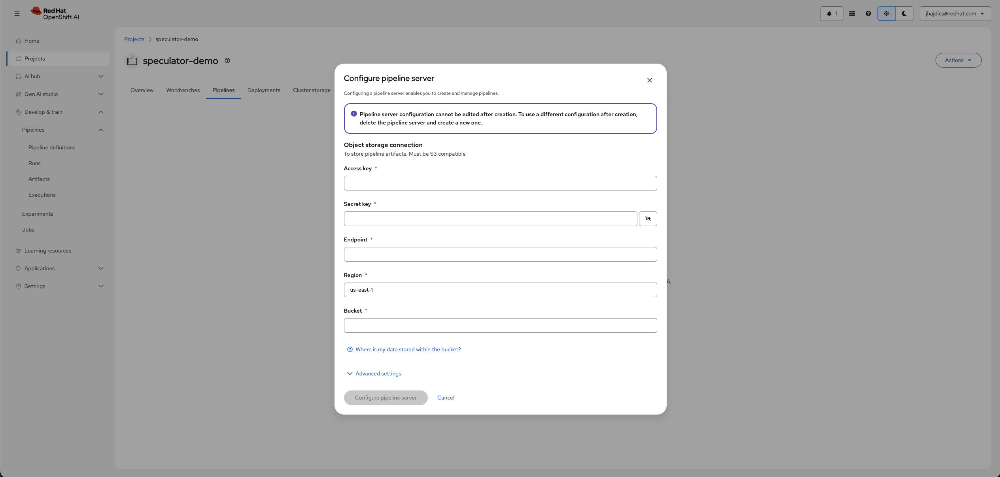
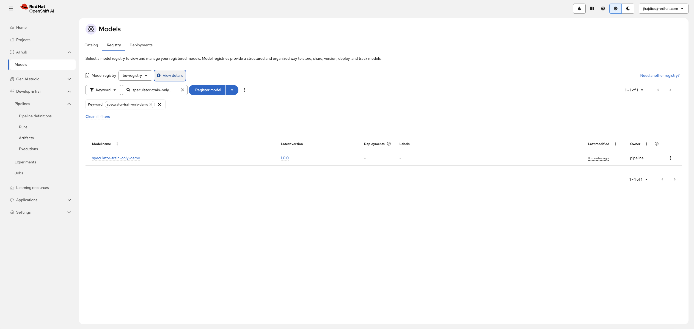
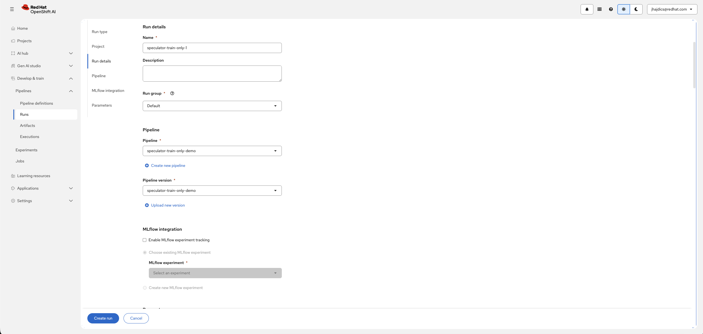
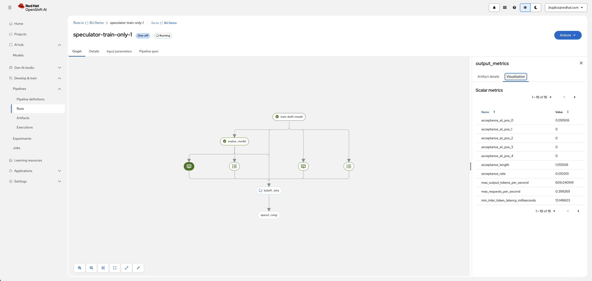
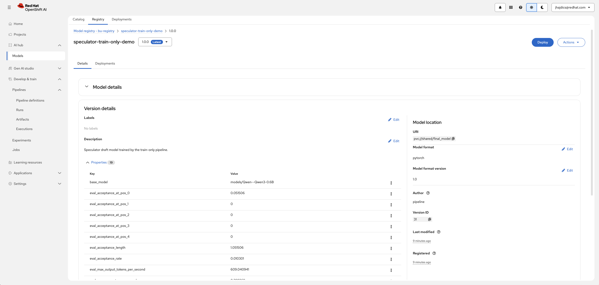
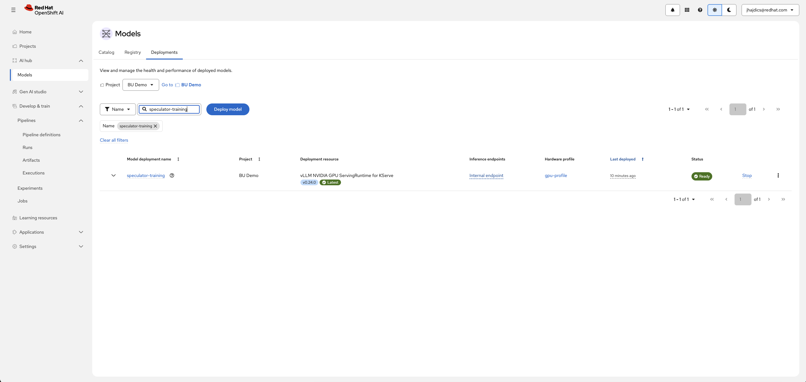

# Train-Only Pipeline (TRAIN_ONLY)

> [!WARNING]
>
> **Stability: alpha** — this pipeline may change. Re-generate the YAML after pulling upstream changes.

This guide covers the **speculator-training-pipeline** — the second step of the two-step speculator workflow. It trains, evaluates, registers, and serves an Eagle3 draft model from artifacts already on the PVC.

## When to use this pipeline

- **Iterate on hyperparameters.** After the [data-extraction pipeline](../data-extraction/) has produced hidden states and processed data, re-run this pipeline alone to sweep epochs, learning rate, or architecture settings — extraction is never repeated.
- **Mandatory Model Registry.** Unlike online/offline, this pipeline **always** registers the trained draft before serving it — registry setup is a hard prerequisite here.

## How it works

The pipeline expects the verifier model, hidden states, and preprocessed dataset from a previous data-extraction run to already exist on the shared PVC. It does **not** download the verifier. Stages:

1. **Train** the Eagle3 draft from the hidden states (Trainer job, `speculator-model-opt-cuda` CTR).
2. **Evaluate** with GuideLLM — acceptance metrics against the verifier without speculation.
3. **Register** the draft to the Kubeflow Model Registry (unconditional).
4. **Serve** via a cluster-local KServe InferenceService for speculative decoding.

The trained draft is copied to `pvc://<p01_persistent_pvc>/final_model` for evaluation, registry, and serving.

Relative storage paths resolve against `p01_persistent_pvc`, and explicit `pvc://<claim>/<path>` paths must reference that same PVC. With `p01_persistent_pvc="shared"`, `p06_verifier_model_pvc="models/Qwen--Qwen3-0.6B"` is equivalent to `pvc://shared/models/Qwen--Qwen3-0.6B`.

## The pipeline run from start to finish

The run graph is a straight line of five tasks — no branches, no optionality (this pipeline always registers):

```text
train draft model ──> evaluate draft model ──> register to model registry ──> serve draft model
```

Stage by stage:

| Task in the graph | What it does | What you'll observe | Typical duration (Qwen3-0.6B smoke test) |
| --- | --- | --- | --- |
| **train draft model** | One Trainer job (`speculator-model-opt-cuda` CTR) trains the Eagle3 draft from the hidden states on the PVC | Logs show per-step training loss decreasing and checkpoint saves. The draft is copied to `final_model` on the PVC at the end | A few minutes (16 extraction samples, 3 epochs) |
| **evaluate draft model** | Starts its own vLLM server with speculative decoding enabled and runs a GuideLLM benchmark sweep against it | Slow to start — the vLLM server takes minutes to load verifier + draft before the sweep begins. Results are published as **metrics artifacts**, not plain logs | ~5–15 minutes |
| **register to model registry** | Registers `final_model` to the Model Registry under `p03_model_registry_name` / `p46_model_registry_version` | The fastest node in the graph — seconds. Fails immediately if the registry address is wrong or the RoleBinding is missing | Seconds |
| **serve draft model** | Creates the KServe InferenceService in `p04_serving_namespace` and waits for it to become ready | Logs show the ServingRuntime and InferenceService being created, then the predictor rollout. The node succeeds only once the endpoint answers | ~2–5 minutes |

A failure at any node stops everything after it, and that node's logs are where to look. The two nodes that fail most often in practice are **evaluate** (vLLM startup timeout — raise `p43_evaluation_startup_timeout_seconds`) and **register** (wrong host/port split or missing RoleBinding — see [Troubleshooting](#troubleshooting)).





## Hardware requirements (Qwen3-0.6B)

| Component | GPU | CPU | Memory |
| --- | --- | --- | --- |
| Training worker | 1 | 4 cores | 64Gi |
| Evaluation / serving | ~1 | — | — |

Expect roughly 10–30 minutes end-to-end for the smoke-test configuration, depending on cluster load — most of it is the evaluation step spinning up its own vLLM server.

## Setup

Work through the [shared prerequisites](../README.md#prerequisites), **all of them** — this pipeline additionally requires:

- **Model Registry**: create/select one in the Red Hat OpenShift AI dashboard (**AI Hub > Models > Model registries**), then find its REST route (`oc get routes -A | grep rest` — for a registry named `bu-registry` it is `bu-registry-rest.apps.<cluster-domain>`) and set `p02_model_registry_address` to the full route URL including the `https://` scheme, with `p45_model_registry_port` = `443`. See the [common prerequisites](../README.md#model-registry-and-kserve-train-only--online--offline) for the full instructions and the in-cluster Service alternative.
- **RoleBinding**: the pipeline ServiceAccount needs a RoleBinding to `registry-user-<registry-name>` in the registry namespace (command in the [common prerequisites](../README.md#model-registry-and-kserve-train-only--online--offline)).
- **Serving namespace**: `p04_serving_namespace` must match the PVC namespace and have the required KServe permissions.
- CTR `speculator-model-opt-cuda` (`p35_job_runtime` default).

The three setup steps this mode depends on, as they look in the dashboard:







All are covered step by step — with verification commands — in the [common prerequisites](../README.md#prerequisites).

## Wiring it to a data-extraction run

The path contract between the two pipelines:

| This pipeline parameter | Must match |
| --- | --- |
| `p08_training_data_path` (default `speculator-output`) | The extraction run's `p06_output_dir` |
| `p09_hidden_states_path` (default `speculator-output/hidden_states`) | The extraction run's output dir + `/hidden_states` |
| `p13_target_layer_ids` | The extraction run's `p18_target_layer_ids` — exactly |
| `p11_total_seq_len` | The extraction run's `p16_total_seq_len` |

Defaults line up out of the box. If you customized the extraction output directory, update the paths here too — they are **not** discovered automatically from previous runs. The verifier must be supplied via `p06_verifier_model_pvc`; when the extraction run used `p04_download_model=true`, point this at the directory it cached — the download task names it after the model ID with `/` replaced by `--` (e.g. `models/Qwen--Qwen3-0.6B`, `models/meta-llama--Llama-3.2-1B-Instruct`). The [data-extraction guide's verification section](../data-extraction/README.md#verifying-the-output-on-the-pvc) shows how to list what was actually cached.

> [!WARNING]
>
> A common mistake is setting `p06_verifier_model_pvc` to the HuggingFace model ID format (e.g. `models/Qwen3-0.6B`) instead of the on-disk directory name (`models/Qwen--Qwen3-0.6B`). The download task replaces `/` with `--` in the model ID — always check `ls $PVC_MOUNT/models/` to confirm the actual directory name before creating a train-only run.

## Preparing the evaluation dataset

The evaluation task benchmarks the trained draft model using [GuideLLM](https://github.com/neuralmagic/guidellm). Set `evaluation_dataset_uri` to a HuggingFace dataset that contains the evaluation subsets expected by the upstream evaluator.

The recommended dataset is [`RedHatAI/speculator_benchmarks`](https://huggingface.co/datasets/RedHatAI/speculator_benchmarks), which ships the `HumanEval` subset (and others like `math_reasoning`, `qa`, `summarization`) that the evaluation script requires. It is public and does not need a HuggingFace token.

### Using a local JSONL file instead

If you prefer to evaluate with your own prompts, prepare a JSONL file with one JSON object per line:

```jsonl
{"prompt": "What is the capital of France?"}
{"prompt": "Explain quantum computing in simple terms."}
{"messages": [{"role": "user", "content": "How does photosynthesis work?"}]}
```

Each record must contain a `prompt` field, a `text` field, or a `messages` array with at least one `user` role entry. Upload the file to your PVC and set `evaluation_dataset_uri` to a `pvc://` URI (e.g. `pvc://shared/eval-prompts.jsonl`). The pipeline samples up to `evaluation_max_samples` prompts (default 80) from the file.

## Running the pipeline

**Step 1 — generate the pipeline YAML.** Follow [Generate the pipeline YAML](../README.md#1-generate-the-pipeline-yaml) in the common guide, compiling the `train_only` mode:

```bash
PYTHONPATH=$(pwd) python pipelines/training/speculator/train_only/pipeline.py
```

This writes `pipelines/training/speculator/train_only/pipeline.yaml`.

**Step 2 — import it into Red Hat OpenShift AI.** Follow the click-by-click instructions in [Import the pipeline into Red Hat OpenShift AI](../README.md#3-import-the-pipeline-into-red-hat-openshift-ai). The imported definition is named `speculator-training-pipeline`.

**Step 3 — create a run.** Open the pipeline definition, click **Create run**, and fill in the parameters from the table below. Leave everything not listed at its default. Use a **new** `p46_model_registry_version` for every trained revision — re-using a version number overwrites the registry entry's meaning.



**Step 4 — start the run and watch it.** Click **Start**. The stage-by-stage walkthrough — what each of the four tasks does and how long it takes — is in [The pipeline run from start to finish](#the-pipeline-run-from-start-to-finish); the common guide covers the [UI mechanics](../README.md#5-watch-the-run) of watching a run.

### Example: Qwen3-0.6B

Assumes a completed data-extraction run with defaults, and the verifier cached by its download task:

| Parameter | Value | Notes |
| --- | --- | --- |
| `p01_persistent_pvc` | `shared` | Same PVC as extraction |
| `p02_model_registry_address` | `https://<registry-name>-rest.apps.<cluster-domain>` | The registry's `-rest` route URL, scheme included |
| `p03_model_registry_name` | `qwen3-06b-draft` | Unique in the registry |
| `p04_serving_namespace` | `<pvc-namespace>` | Must access the PVC |
| `p05_serving_endpoint_name` | `qwen3-06b-speculator` | DNS-compatible |
| `p06_verifier_model_pvc` | `models/Qwen--Qwen3-0.6B` | Where extraction cached it — verify on the PVC |
| `p07_evaluation_dataset_uri` | `RedHatAI/speculator_benchmarks` | HuggingFace evaluation dataset with built-in subsets |
| `p13_target_layer_ids` | `2,14,25,28` | Must match the extraction run |
| `p36_packages_to_install` | `speculators==0.6.0.1,torchvision==0.24.0` | Comma-separated packages installed in the training job |
| `p38_evaluation_max_samples` | `10` | Reduced for quick testing; default `80` for full runs |
| `p39_evaluation_max_tokens` | `64` | Reduced for quick testing; default `256` for full runs |
| `p45_model_registry_port` | `443` | **Required with a route address** — the default `8080` only fits the in-cluster service |

The `evaluation_max_samples` and `evaluation_max_tokens` values above are reduced to speed up a smoke-test run. For production evaluation, leave them at their defaults (`80` and `256`).

## What gets trained

Only the draft model — the verifier is never modified. Defaults train a 1-layer draft (`p17_training_num_layers`) with a linear LR scheduler over 3 epochs at learning rate `1e-4`. The draft vocabulary size is derived automatically when `p16_training_draft_vocab_size=0`.

## Interpreting the evaluation results

The **evaluation task** benchmarks the served draft with GuideLLM and logs its results as KFP **metrics artifacts** — not plain log output. To find them: open the run in the Red Hat OpenShift AI UI, click the evaluation node, and look at its **Artifacts / Metrics** output.



### Acceptance metrics

| Metric | Meaning |
| --- | --- |
| `acceptance_rate` | Accepted draft tokens ÷ proposed draft tokens. The headline quality number for the draft. |
| `acceptance_length` | `1 + (accepted tokens ÷ drafts)` — the mean number of tokens produced per verifier pass, including the verifier's own token. This is the figure that translates most directly into speedup. |
| `acceptance_at_pos_N` | Acceptance rate at each position within a draft. It falls off with position: position 0 is the easiest guess, and later positions are only reached if every earlier one was accepted. |
| `num_drafts`, `num_draft_tokens`, `num_accepted_tokens` | The raw counts the ratios above are computed from. |

With `p41_num_speculative_tokens=5`, each draft proposes 5 tokens, so `acceptance_length` ranges from 1 (every guess rejected — speculation gained nothing) up to 6 (all five accepted). A rejection ends the draft: the verifier emits its own token and the next draft starts from scratch, which is why `acceptance_length` grows faster than `acceptance_rate` does — the long fully-accepted runs are what pay off.

Treat these as orientation, not thresholds: an `acceptance_length` near 1 means the draft is contributing nothing and something is wrong (too little training data, mismatched `target_layer_ids`, or a draft/verifier mismatch), while a value well above 2 means the draft is earning its keep.

### Throughput metrics

| Metric | Meaning |
| --- | --- |
| `max_output_tokens_per_second` | Peak output throughput across the GuideLLM sweep. |
| `max_requests_per_second` | Peak request throughput. |
| `min_latency_median_seconds` | Best median end-to-end request latency. |
| `min_inter_token_latency_milliseconds` | Best median delay between consecutive output tokens. |

> [!NOTE]
>
> The pipeline does **not** emit a speedup ratio. These are absolute numbers for the speculative endpoint only. To quantify speedup, benchmark the same verifier without speculation under the same conditions and compare `max_output_tokens_per_second` yourself.

One more thing to set expectations before you judge a first run:

> [!IMPORTANT]
>
> Smoke-test settings (e.g. 16 extraction samples, default epochs) produce a **weak draft on purpose** — the point is to prove the plumbing. Expect poor acceptance numbers on a first smoke run; see [Iterating on hyperparameters](#iterating-on-hyperparameters) for what to change.

### Checking the registry entry

After the run succeeds, the draft appears in the Model Registry: **AI Hub > Models > Model registries > your registry**, under the name you set in `p03_model_registry_name`, with the version from `p46_model_registry_version`.



## Testing the served endpoint

The run leaves a **cluster-local** KServe InferenceService. The full procedure — including the laptop port-forward variant — is in the [common guide](../README.md#testing-the-served-endpoint); the essentials:

```bash
# 1. Find the InferenceService and confirm it is ready (True):
oc get inferenceservice -n <p04_serving_namespace>

# 2. Discover the model id — it is the InferenceService name,
#    NOT the verifier model ID:
oc exec -n <p04_serving_namespace> deploy/<p05_serving_endpoint_name>-predictor -c kserve-container -- \
  curl -s localhost:8080/v1/models

# 3. Ask it something:
oc exec -n <p04_serving_namespace> deploy/<p05_serving_endpoint_name>-predictor -c kserve-container -- \
  curl -s localhost:8080/v1/chat/completions \
  -H "Content-Type: application/json" \
  -d '{"model": "<p05_serving_endpoint_name>", "messages": [{"role": "user", "content": "What is the capital of France?"}], "max_tokens": 200}'
```

The answer is in `choices[0].message.content`. Note the server is vLLM behind KServe; the first request after the run may take a moment while the model loads into GPU.



A note on reading the result: with speculative decoding the output is still **correct** regardless of draft quality — the verifier guarantees the tokens; a bad draft only costs speed. So a sensible answer tells you the whole stack works; whether the draft is *good* is what the [acceptance metrics](#interpreting-the-evaluation-results) tell you.

## Iterating on hyperparameters

Because extraction is reused, iterating is cheap — re-run **only this pipeline** with a new `p46_model_registry_version` and adjusted parameters:

- More data (the first thing to fix after a smoke test): re-run **extraction** with `p08_max_samples=0` for the full dataset, then train-only again.
- More training: raise `p14_training_epochs` or tune `p15_training_lr`.
- Bigger draft: raise `p17_training_num_layers`.
- Different speculation depth: `p41_num_speculative_tokens` (affects evaluation and serving).

Watch the acceptance metrics after each iteration and keep the best revision in the registry. `final_model` on the PVC is overwritten every run — if earlier registry versions must keep referencing their original weights, use a separate PVC per revision.

## Full Parameter Reference

| Parameter | Type | Default | Description |
| --------- | ---- | ------- | ----------- |
| `p01_persistent_pvc` | `str` | `None` | Name of an existing ReadWriteMany PVC mounted at `/mnt/persistent`; stores the verifier, hidden states, training data, and model output. |
| `p02_model_registry_address` | `str` | `None` | Required Model Registry REST endpoint: the registry's `https://<name>-rest.apps.<cluster-domain>` route URL (scheme included), or the in-cluster service hostname. |
| `p03_model_registry_name` | `str` | `None` | Required model name, unique in the selected registry. |
| `p04_serving_namespace` | `str` | `None` | Namespace where KServe creates the endpoint; must match the PVC namespace and have required permissions. |
| `p05_serving_endpoint_name` | `str` | `None` | Required DNS-compatible KServe InferenceService name. |
| `p06_verifier_model_pvc` | `str` | `None` | Required existing verifier directory on `p01_persistent_pvc`. Use the on-disk directory name (`models/Qwen--Qwen3-0.6B`), not the HuggingFace model ID — the download task replaces `/` with `--`. Relative path or matching `pvc://` URI. |
| `p07_evaluation_dataset_uri` | `str` | `None` | Required evaluation dataset. Use `RedHatAI/speculator_benchmarks` (HuggingFace) or a `pvc://` URI pointing to a local JSONL file on `p01_persistent_pvc`. See [Preparing the evaluation dataset](#preparing-the-evaluation-dataset). |
| `p08_training_data_path` | `str` | `speculator-output` | Directory containing the preprocessed dataset from the data extraction pipeline. |
| `p09_hidden_states_path` | `str` | `speculator-output/hidden_states` | Existing hidden-state directory from data-only extraction. |
| `p10_output_dir` | `str` | `speculator-output` | Checkpoint and output directory on `p01_persistent_pvc`. |
| `p11_total_seq_len` | `int` | `2048` | Positive sequence length for preprocessing and training; keep consistent with the extraction run. |
| `p12_speculator_type` | `str` | `eagle3` | Draft architecture. `eagle3` is currently supported. |
| `p13_target_layer_ids` | `str` | `2,14,25,28` | Four comma-separated verifier layer IDs. Use the same IDs as the extraction run. |
| `p14_training_epochs` | `int` | `3` | Positive number of training epochs. |
| `p15_training_lr` | `float` | `0.0001` | Positive learning rate for draft-model training. |
| `p16_training_draft_vocab_size` | `int` | `0` | Draft vocabulary size. `0` lets the SDK derive it. |
| `p17_training_num_layers` | `int` | `1` | Number of layers in the draft model. |
| `p18_training_test_time_steps` | `int` | `1` | Number of test-time training steps configured for Speculator. |
| `p19_training_norm_before_residual` | `bool` | `True` | Apply normalization before the residual connection. |
| `p20_training_norm_before_fc` | `bool` | `False` | Apply normalization before the fully connected layer. |
| `p21_training_embed_requires_grad` | `bool` | `False` | Whether draft embedding weights are trainable. |
| `p22_training_hidden_states_dtype` | `str` | `bfloat16` | Hidden-state dtype; must match the verifier. |
| `p23_training_scheduler_type` | `str` | `linear` | LR scheduler: `linear`, `cosine`, or `none`. |
| `p24_training_scheduler_warmup_steps` | `int` | `0` | Warmup steps; `0` lets the SDK calculate 1% of total steps. |
| `p25_training_scheduler_total_steps` | `int` | `0` | Total scheduler steps; `0` lets the SDK calculate them. |
| `p26_training_scheduler_num_cosine_cycles` | `float` | `0.5` | Cosine cycles, used only by the cosine scheduler. |
| `p27_training_checkpoint_freq` | `float` | `1.0` | Checkpoint interval in epochs. |
| `p28_training_save_best` | `bool` | `False` | Save only the best checkpoint by validation loss. |
| `p29_training_log_freq` | `int` | `1` | Training steps between log updates. |
| `p30_training_resume_from_checkpoint` | `bool` | `False` | Resume when the runtime supports it. |
| `p31_training_resource_cpu` | `str` | `4` | CPU request for the training worker. |
| `p32_training_resource_gpu` | `int` | `1` | Number of GPUs requested for the training worker. |
| `p33_training_resource_memory` | `str` | `64Gi` | Memory request for the training worker. |
| `p34_job_envs` | `str` | `NCCL_DEBUG=INFO,PYTHONUNBUFFERED=1` | Comma-separated `KEY=VALUE` environment overrides for the job. |
| `p35_job_runtime` | `str` | `speculator-model-opt-cuda` | Name of the runtime used by the job. |
| `p36_packages_to_install` | `str` | `""` | Comma-separated Python packages to install for the training job. |
| `p37_pip_index_urls` | `str` | `""` | Comma-separated package index URLs to use for installs in the training job. |
| `p38_evaluation_max_samples` | `int` | `80` | Maximum requests per evaluation sweep point; must be positive. |
| `p39_evaluation_max_tokens` | `int` | `256` | Maximum generated tokens per evaluation request; must be positive. |
| `p40_evaluation_temperature` | `float` | `0.0` | GuideLLM sampling temperature; `0` is deterministic. |
| `p41_num_speculative_tokens` | `int` | `5` | Draft tokens proposed per step for evaluation and serving. |
| `p42_gpu_memory_utilization` | `float` | `0.9` | GPU memory fraction for evaluation and serving, in `(0, 1]`. |
| `p43_evaluation_startup_timeout_seconds` | `int` | `900` | Maximum wait for the evaluation vLLM server. |
| `p44_evaluation_sample_seed` | `int` | `42` | Seed for sampling from a local evaluation dataset. |
| `p45_model_registry_port` | `int` | `8080` | Registry REST port: `443` for the `-rest` route, `8080` for the in-cluster service. |
| `p46_model_registry_version` | `str` | `1.0.0` | Version label for this registration; use a new version per revision. |
| `p47_serving_runtime_image` | `str` | `registry.redhat.io/rhaii-fast/vllm-cuda-rhel9@sha256:97c7d6f66f3f0897b3ff10ddd135de930d45bdd116cf41a43e3ad7270029116a` | Red Hat CUDA runtime image used by KServe for Eagle3 draft serving (contains vLLM 0.28.0+rhaiv.7). Override only with a compatible image. |

## Troubleshooting

| Symptom | Diagnosis | Fix |
| --- | --- | --- |
| Training task fails: hidden states not found | Paths don't match the extraction run's output | Align `p08`/`p09`/`p10` with the extraction run's `p06_output_dir`; check the PVC per the [data-extraction guide](../data-extraction/README.md#verifying-the-output-on-the-pvc) |
| Training fails with a layer/tensor shape mismatch | `p13_target_layer_ids` or `p11_total_seq_len` differs from the extraction run | Set both to exactly the extraction run's values |
| Registry task fails with connection refused | Wrong host/port split or missing RoleBinding | Use the `-rest` route URL with `https://` and port `443` (or the in-cluster service with `8080`); add the RoleBinding |
| Serving task fails with forbidden | ServiceAccount lacks KServe permissions in `p04_serving_namespace` | Grant ServingRuntime/InferenceService manage rights |
| Training pod OOM-killed | Verifier too large for defaults | Raise `p33_training_resource_memory` |
| Older registry versions break after a re-run | `final_model` on the PVC is overwritten each run | Use a separate PVC per revision if old versions must keep referencing their weights |
| Training fails: `HFValidationError: Repo id must be in the form 'repo_name' or 'namespace/repo_name'` | `p06_verifier_model_pvc` uses the HuggingFace model ID format (e.g. `models/Qwen3-0.6B`) instead of the on-disk directory name | The download task replaces `/` with `--` in the model ID. Use the actual directory name: `models/Qwen--Qwen3-0.6B`. Check with `ls $PVC_MOUNT/models/` |
| Chat request to the endpoint returns "model not found" | Wrong model id — the server registers the model under the InferenceService name | Discover the id via `/v1/models`; see [Testing the served endpoint](#testing-the-served-endpoint) |

Compile-time problems and endpoint-access problems (cluster-local DNS, port-forwarding) are covered in the [common troubleshooting table](../README.md#troubleshooting).

## Source

Pipeline source: [`pipelines-components/pipelines/training/speculator/train_only`](https://github.com/red-hat-data-services/pipelines-components/tree/main/pipelines/training/speculator/train_only). The parameter table above is derived from that directory's `README.md` and `pipeline.py`; re-check it against your imported definition after pulling upstream changes.
